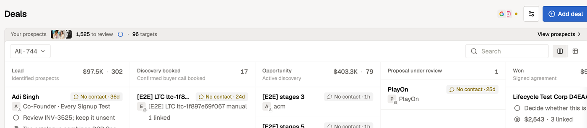
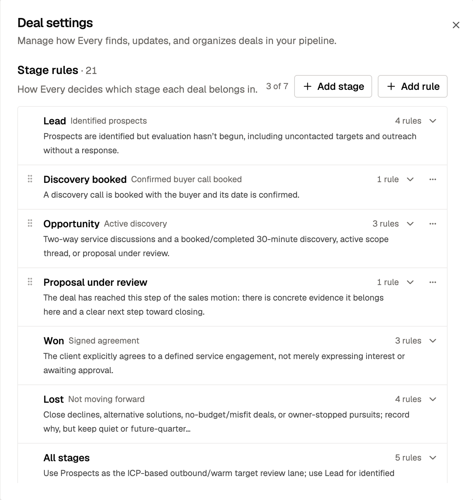
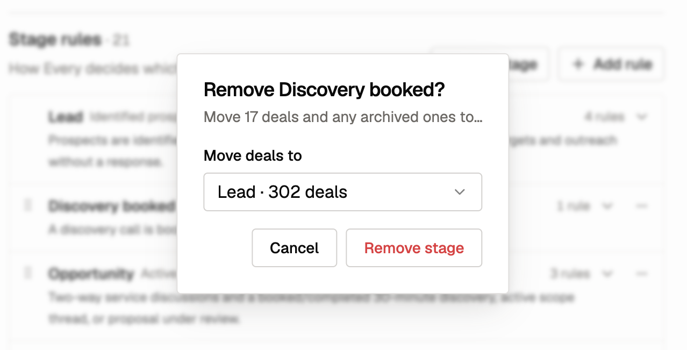

## Overview

The **Sales Pipeline** is where Every turns a promising relationship into a managed sales process. Warm leads discovered by the [Prospecting Agent](/prospecting/prospecting-agent) arrive for review on the **Prospects** page; approved leads get a plan, outreach drafts, linked proposals and invoices, and a history of what happened.

Every prepares and updates the work, while you control who enters the pipeline and what gets sent. Deals stay current from your Gmail, LinkedIn, and Instagram conversations, and for any deal you choose, [Auto mode](/prospecting/auto-mode) lets Every send replies and follow-ups on its own.

<Card title="Open Deals" icon="git-branch" href="https://app.every.ai/" horizontal>
  View and manage your deals on the AI pipeline, now the **Deals** page — the first item in the left nav
</Card>

## Pipeline stages

Each workspace has its own stages. **Lead** is always the first column, and **Won** and **Lost** are always the last two. Between Lead and Won you can have up to seven stages of your own, such as Discovery booked or Proposal sent. A new workspace starts with one middle stage, **Opportunity**.

Prospects are not a column. They live on their own [**Prospects**](https://app.every.ai/prospects) page, and the Deals header shows **Prospects · N** to get there.

<Frame>
  
</Frame>

| Stage | What it means |
|-|-|
| **Lead** | An approved prospect before a meaningful sales motion is underway. Always first. |
| **Your middle stages** | The steps of your sales process, in the order you set. A new workspace has one: **Opportunity**, an active sales motion from a positive reply through proposal, invoice, and close. |
| **Won** | Work closed successfully under your stage rules. Always after your middle stages. |
| **Lost** | Work closed unsuccessfully or intentionally parked. Always last. |

The board, the table view, filters, the deal sheet, and each deal's history all use your stage names. Proposal and invoice status appear on the deal, so you do not need a stage for each document.

## Customize your stages

Add, rename, reorder, or remove the stages between Lead and Won.

**To open the editor:** On [**Deals**](https://app.every.ai/), select the **Deal settings** button in the header. The **Stage rules** section lists every stage in order and shows how many of your seven middle stages you use.

<Frame>
  
</Frame>

- **Add a stage:** Select **Add stage**, type a name, and select **Add**. The new stage appears before Won. You can have up to 7 stages between Lead and Won.
- **Rename a stage:** Select **⋯** on the stage → **Rename**.
- **Reorder stages:** Drag a middle stage by its handle to a new place. The new order saves when you drop it.
- **Remove a stage:** Select **⋯** on the stage → **Remove**. See [Removing a stage](#removing-a-stage).

Lead, Won, and Lost cannot be renamed, moved, or removed. Stage names can be up to 40 characters and must be unique in your workspace. Names that Every keeps for its built-in stages, such as Lead, Opportunity, Won, Lost, Prospect, and Qualified, cannot be used for a new stage.

<Note>
  Only workspace admins can add, rename, reorder, or remove stages. Anyone in the workspace can edit a stage's rules.
</Note>

### Removing a stage

Removing a stage never deletes deals. When you select **Remove**, Every asks where the stage's deals should go. Pick any open stage under **Move deals to** (Lead or another middle stage), then select **Remove stage**.

<Frame>
  
</Frame>

Every moves the deals, including archived ones, in the background. The column shows the progress and disappears when every deal has moved. Moved deals keep their history, and Every updates their plans for the new stage.

## Stage rules

Stage rules tell Every what each stage means for your business. They set the goal the agent works toward at each stage: how it plans each deal, which stage it thinks a deal is in, and what it tries to get out of each conversation, especially in [Auto mode](/prospecting/auto-mode). Every stage has rules, including the ones you add.

For some businesses a reply is enough to count as an Opportunity; for others it takes a booked meeting. Write the rules that match how you sell.

**To edit them:** On [**Deals**](https://app.every.ai/), select the **Deal settings** button in the header. Under **Stage rules**, open a stage to edit or remove its rules, or select **Add rule** and pick the stage it applies to. Rules that Every learned from your guidance, stage moves, and archived deals appear with the stage they apply to; **All stages** holds the ones that apply everywhere.

**For a single deal:** Open the deal and select **View stage rules** next to its stage to see or change the rules for that deal only.

## Ask Every about your stages

Every reads your workspace's stages, so you can use your own stage names in chat.

<Tip>
  Ask Every Agent: "What stages do I have?", "Move Acme to Discovery booked", or "Add a deal for Northwind in Proposal sent".
</Tip>

Every can create a new deal in Lead or any of your middle stages. Connected assistants (ChatGPT, Claude, and other MCP clients) and the [Every CLI](/cli/every-cli) accept a stage's name or its key wherever a tool takes a stage, and an assistant can also record a past deal directly in Won or Lost. In the CLI, `every deal stages` lists your stages in order. If you give a stage name that does not exist, the reply lists the stages you have.

## On mobile

The Every iPhone app shows your stages on the board and their rules in **Deal settings**. To add, rename, reorder, or remove stages, select **Manage stages on web**.

## How deals get into the pipeline

- **Prospecting:** Every scores your network for each target and lists qualified matches on the Prospects page. Approving one adds it to Lead.
- **Manual deals:** Add a person or company directly to Lead or any of your middle stages.
- **Commercial activity:** When configured, proposals or invoices created outside the board can be linked to a deal so the sales and billing records stay connected.

## Review prospects

Prospects are reviewed on their own page, not on the board. See [Review before anything happens](/prospecting/prospecting-agent#review-before-anything-happens) for Approve, Add to deal, Reject, and bulk actions. No message is sent from Prospects.

## Plans, outreach, and activity

Each approved deal has a plan made of concrete next steps. The agent refreshes that plan when relevant facts change—for example, after you log a conversation, move the stage, send outreach, receive a reply, or link a proposal or invoice.

Open a deal to:

- Review the current plan and its rationale
- Edit and send an outreach draft by email, or send a LinkedIn message with **Send via Every**
- Turn [Auto mode](/prospecting/auto-mode) on or off
- Log a call, meeting, note, or attachment
- Draft a proposal
- Link or inspect proposals and invoices
- Change the deal owner on a team workspace
- Review the chronological history

<Note>
  An agent-generated draft is not a sent message. Unless [Auto mode](/prospecting/auto-mode) is on for the deal, outreach is sent only after you review it and choose to send.
</Note>

### Sending on LinkedIn and Instagram

When a plan step is a LinkedIn or Instagram message, Every drafts it for that channel.

- **LinkedIn:** select **Send via Every**. Every shows the message and recipient, then sends it from your connected LinkedIn account when you confirm.
- **Instagram:** select **Copy message** and send it from Instagram.

Connect both from [LinkedIn & Instagram](/integrations/linkedin-and-instagram).

## Conversations keep deals current

Every reads the conversations you have with a deal's contact on Gmail, LinkedIn, and Instagram, including messages you send outside Every, and attaches each one to the right person and deal:

- A positive reply can move the deal to a later stage and trigger a new plan.
- A neutral reply updates the plan without forcing a stage change.
- A negative reply is recorded so the agent does not plan from stale assumptions.

Each deal's activity, next steps, and stage update as new messages arrive, so the board shows where each conversation stands and which channel reaches each person.

Gmail and Calendar events can provide real-time context, and the Deal Sync routine checks for replies as a catch-up path. LinkedIn and Instagram messages sync on their own while **Sync deal-related messages** is on for that network. See [LinkedIn & Instagram](/integrations/linkedin-and-instagram#what-syncs).

## Proposals and invoices

The pipeline connects sales activity to the documents that close and collect the work.

- **Draft a proposal** from the deal so the client, scope context, and pipeline link stay together.
- **Convert an issued or approved proposal to an invoice** when you are ready to bill.
- **Link an invoice** so issued and paid status can update the deal's commercial context.
- **Move to Won** after linking or creating the Person or Company record required for the closed deal - Won accepts either party type, so a solo individual never needs a company just to close.

See [Invoices & Proposals](/billing/invoices-and-proposals) for the full proposal-to-invoice workflow.

## Human control and learning

Manual stage moves are authoritative: the agent replans around the stage you chose. Every also learns from durable signals such as rejections with reasons, edited outreach, stage moves, and won/lost outcomes. You can review prospecting lessons under **What Every learned** in **Prospecting settings** on the Prospects page, separately from the plan for an individual deal.

## Frequently asked questions

<AccordionGroup>
  <Accordion title="Does Every send outreach automatically?">
    Not by default. The pipeline agent prepares the plan and draft, and you review the message and initiate the send. If you turn on [Auto mode](/prospecting/auto-mode) for a deal, Every replies and follows up with that deal's contact on its own, inside existing Gmail, LinkedIn, or Instagram conversations. Each message waits a few minutes so you can cancel it.
  </Accordion>

  <Accordion title="Where do I change what counts as an Opportunity or a Win?">
    In [stage rules](#stage-rules): Deals → **Deal settings** → **Stage rules**. The agent plans and moves deals against those rules.
  </Accordion>

  <Accordion title="Can I add my own stages?">
    Yes. A workspace admin can add up to seven stages between Lead and Won, and rename, reorder, or remove them. See [Customize your stages](#customize-your-stages).
  </Accordion>

  <Accordion title="What happens to deals when I remove a stage?">
    Nothing is deleted. You choose an open stage for its deals, Every moves them in the background, and the column disappears when the move is done.
  </Accordion>

  <Accordion title="Is Prospects a pipeline stage?">
    No. Prospects is a review list for agent-discovered matches on the Prospects page. A prospect enters the active pipeline only after approval.
  </Accordion>

  <Accordion title="Why does Every need a Person or Company before Won?">
    The Person or Company record connects the deal to proposals, invoices, payments, and revenue. If one is missing, Every asks you to link an existing person or company, or create one from the deal - a Person alone is enough, no company is required.
  </Accordion>

  <Accordion title="Can I move a deal myself?">
    Yes. Drag the deal to another stage, or ask Every to move it ("Move Acme to Discovery booked"). Your move takes precedence, and the agent updates the plan for the stage you selected.
  </Accordion>
</AccordionGroup>

## Next steps

<CardGroup cols={2}>
  <Card title="Prospecting Agent" icon="telescope" href="/prospecting/prospecting-agent">
    Find and score warm leads from your existing network
  </Card>

  <Card title="Auto mode" icon="zap" href="/prospecting/auto-mode">
    Let Every reply and follow up on a deal without asking first
  </Card>

  <Card title="LinkedIn & Instagram" icon="messages-square" href="/integrations/linkedin-and-instagram">
    Keep deals current from your LinkedIn and Instagram messages
  </Card>

  <Card title="Invoices & Proposals" icon="file-text" href="/billing/invoices-and-proposals">
    Turn accepted work into billing
  </Card>

  <Card title="Scheduled Tasks" icon="clock" href="/scheduled-tasks/scheduled-tasks">
    Manage other recurring agent tasks
  </Card>

  <Card title="Companies" icon="building-2" href="/network/companies">
    Manage the company records connected to won work
  </Card>

  <Card title="People" icon="user-round" href="/network/people">
    Manage the people records connected to won work, including deals billed directly to a Person
  </Card>
</CardGroup>

<Note>
  **Need help?** Contact support at [hello@every.ai](mailto:hello@every.ai)
</Note>
